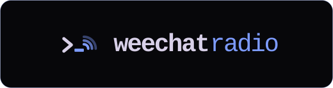

<p align="center">
  <a href="https://weechatradio.com">
    
  </a>
</p>

<p align="center"><strong>Chat that keeps working when the internet does not.</strong></p>

<p align="center">
  <a href="https://www.rust-lang.org/"></a>
  <a href="LICENSE"></a>
  <a href="https://github.com/thaum-labs/weechat-radio/releases"></a>
  <a href="https://github.com/thaum-labs/weechat-radio/actions/workflows/ci.yml?query=branch%3Amain"></a>
  <a href="https://github.com/thaum-labs/weechat-radio/releases/latest"></a>
  
  <br/>
  <a href="https://weechat.org/"></a>
  <a href="https://github.com/RFnexus/modem73"></a>
  
  <a href="https://weechatradio.com/guides/pi.html"></a>
  
  <a href="https://weechatradio.com"></a>
</p>

## What is this?

`wcr` is a small program that talks to [WeeChat](https://weechat.org/) like an IRC server and to [modem73](https://github.com/RFnexus/modem73) like a TNC. Chat over the internet, over HF/VHF radio, or both. Messages store-and-forward, so nobody has to leave a radio on all night.

- Chat from the desktop app (`wcr gui`), a terminal UI (`wcr tui`), or WeeChat
- Run internet-only, radio-only, or both at once
- Send email over the radio through a gateway station
- Run an always-on gateway on a Raspberry Pi with a web portal for status, chat and mail
- Appear on the public map: [weechatradio.com/map.html](https://weechatradio.com/map.html)

**You do not need a radio** to try internet mode. **You do not need WeeChat**: the desktop app or TUI is enough.

WeeChat is a trademark of Sébastien Helleu. This project is independent.

> Early software: it works, but things may still change.

---

## Quick start

### Linux / macOS

```bash
curl -fsSL https://weechatradio.com/install.sh | sh
wcr setup   # callsign, grid, radio, hub/map choices, service
wcr gui     # or: wcr tui
```

### Windows (PowerShell, run as administrator)

```powershell
irm https://weechatradio.com/install.ps1 | iex
```

Leave the window open; WeeChat installs through Cygwin after the program and can take several minutes. Then open **WeeChat Radio** from the Start menu. First launch is setup.

You are set up when the status bar shows your callsign. Send a line in `#bulletin`: `[tx]` means sent, `[ok]` means delivered, `[no]` means it never got through.

**Updating needs no terminal.** In the desktop app, click the version at the bottom left; on a Pi, open the web page's **Software** card. Press **Update**: it checks the SHA-256, installs, waits for the radio to go quiet, restarts on the new version and shows it. The station comes back as you left it. If the new version does not start, the previous one comes back and the app says so. Release candidates are for the terminal only: `wcr update --rc`. In a terminal, `wcr update` does the same and ends with one line (`Updated to 1.0.16, running, radio idle.`); `wcr status` and `wcr restart` need no sudo. Trouble? See the [troubleshooting page](https://weechatradio.com/guides/troubleshooting.html).

---

## Modes

Switch with `/radio mode <name>` or `F2` in the TUI.

| Mode | What it does |
|------|--------------|
| `internet` | Chat with no radio. This computer talks to the hub. |
| `internet-radio` | Radio plus internet. This computer is a gateway: it keys the radio, talks to the hub, and carries other stations' radio-plus traffic onward. |
| `radio` | Radio only. A gateway that hears you leaves the message on the air. |
| `radio-plus` | Radio only from this computer, but a gateway that hears you may carry the message and email onto the internet. Mail finds a gateway by itself (Auto), or goes to one you name. |

Details and a worked example: [modes](https://weechatradio.com/docs/modes.html) or `wcr help modes`.

---

## Radio

You need a valid licence, a radio, and audio into the PC. modem73 is the TNC; the installers put it next to `wcr`. Run `wcr setup`, pick your radio by name, or choose "Other setup" for one of these paths:

| Path | What you need |
|------|----------------|
| Supported radio | VR-N76 / UV-PRO / GA-5WB, VR-N7600 (Bluetooth); Xiegu X6100, X6200, G90, G106, X5105, Yaesu FT-710, QRP Labs QDX, (tr)uSDX (CAT); AnyTone AT-5555N, Retevis RT95 (Digirig); IC-980 Pro (VOX). Setup fills in the rest |
| Handheld + Digirig | VHF/UHF HT and a [Digirig](https://digirig.net/) (or AIOC) USB cable |
| VOX cable | Any radio that keys on VOX, plus a 3.5 mm audio cable |
| HF + CAT | HF rig with CAT for PTT and frequency |
| KISS TNC | Mobilinkd, `/dev/rfcomm0`, or any KISS TNC on a serial port |

Set squelch to 0 for data. The app shows the receive level in words (good, low, high, clipping) and names the knob to turn; RX gain and TX level are set from the app or with `/level`. Busy detection is automatic: data signal on VHF/UHF FM, audio level on HF. Check your band plan before you transmit.

Guides: [radio setup](https://weechatradio.com/guides/radio.html) · [VR-N76 / UV-PRO](https://weechatradio.com/guides/vr-n76.html) · [handheld + Digirig](https://weechatradio.com/guides/handheld.html) · [VOX](https://weechatradio.com/guides/vox.html) · [HF + CAT](https://weechatradio.com/guides/hf.html) · [Raspberry Pi gateway](https://weechatradio.com/guides/pi.html)

---

## Using WeeChat

WeeChat is optional. To add it:

```
wcr weechat --configure
wcr node
wcr weechat
```

Step-by-step: [WeeChat guide](https://weechatradio.com/guides/weechat.html)

---

## Helpful links

- Live map + hub: [weechatradio.com/map.html](https://weechatradio.com/map.html)
- Changelog: [changelog](https://weechatradio.com/changelog.html)
- Email over radio: [docs/email](https://weechatradio.com/docs/email.html)
- Protocol: [docs/protocol](https://weechatradio.com/docs/protocol.html)
- Public API: [docs/api](https://weechatradio.com/docs/api.html)

---

## Build from source

```bash
git clone https://github.com/thaum-labs/weechat-radio.git
cd weechat-radio
cargo install --path crates/wcr
wcr setup
wcr gui
```

Rust 1.89 or newer. On Linux, `wcr gui` needs GTK 3, `libxkbcommon-x11`, and Ayatana AppIndicator. On Windows, the MSVC build tools. `--no-default-features` skips the desktop GUI.

```
crates/wcr/     node, hub, desktop GUI, TUI, modem73 client, local IRC server
weechat/        WeeChat helper script (GPL-3.0-or-later)
web/            weechatradio.com source
docs/           operator guides
install/        install.sh, install.ps1, Homebrew / Scoop / WinGet stubs
deploy/         hub deployment
```

`cargo test --workspace` and `cargo fmt --all` before a PR. Copy `.githooks/pre-commit` to `.git/hooks/pre-commit` to block unformatted commits.

---

## Licence

Apache-2.0 for the daemon, hub, and website. The WeeChat script `weechat/radio.py` is GPL-3.0-or-later. See [`LICENSE`](LICENSE), [`NOTICE`](NOTICE), and [`weechat/LICENSE`](weechat/LICENSE).

Created by **Thaum Labs**
