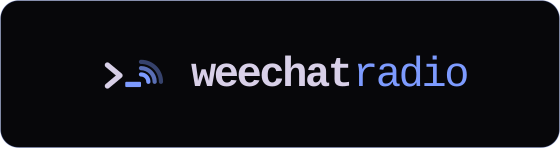

<p align="center">
  <a href="https://weechatradio.com">
    
  </a>
</p>

<p align="center"><strong>Chat that keeps working when the internet does not.</strong></p>

<p align="center">
  <a href="https://www.rust-lang.org/"></a>
  <a href="LICENSE"></a>
  
  
  <br/>
  <a href="https://weechat.org/"></a>
  <a href="https://github.com/RFnexus/modem73"></a>
  
  
  <a href="https://weechatradio.com"></a>
</p>

## What is this?

A small program (`wcr`) that talks to [WeeChat](https://weechat.org/) like an IRC server, and talks to [modem73](https://github.com/RFnexus/modem73) like a TNC. You can use the internet, HF/VHF radio, or both. Messages store-and-forward so nobody has to leave a radio on all night.

With WeeChat Radio you can:

1. Chat from the desktop app (`wcr gui`), a terminal UI (`wcr tui`), or WeeChat
2. Run internet-only, radio-only, or both at once
3. Store and forward messages so stations catch up later
4. Appear on the public map: [weechatradio.com/map.html](https://weechatradio.com/map.html)

The site, desktop app, TUI, and CLI share one dark terminal shell: indigo `#7d9bff` prompts, orange accents, and the chevron-and-waves mark. The mark recolours with the live station mode (cyan / green / amber / magenta). The default UI theme is `tron`; change it with `/radio theme hacker` or `/radio theme terminal`.

**You do not need a radio** to try internet mode.
**You do not need WeeChat** — the desktop app or TUI is enough.

WeeChat is a trademark of Sébastien Helleu. This project is independent.

> Early software — it works, but things may still change.

---

## Quick start

Best way to get the **latest** version: install from [weechatradio.com](https://weechatradio.com).

### Linux / macOS

```bash
curl -fsSL https://weechatradio.com/install.sh | sh
wcr setup   # 7 steps: callsign, grid, radio path, hub/map choices, service
wcr gui
```

Prefer a terminal? `wcr tui` is the same station.

### Windows (PowerShell)

Open PowerShell with **Run as administrator** (Start, type `PowerShell`, right-click, Run as administrator). Paste:

```powershell
irm https://weechatradio.com/install.ps1 | iex
```

Leave the window open. WeeChat installs through Cygwin after the program and can take several minutes. Then open **WeeChat Radio** from the Start menu. First launch is setup; then you chat in the window. If it stops, see the [troubleshooting page](https://weechatradio.com/guides/troubleshooting.html).

```powershell
# optional, same window from a terminal:
wcr gui
```

`wcr update` downloads a newer release, checks its SHA256, and replaces the binary. On Linux and macOS it restarts a station installed with `wcr service install`. A station you started by hand (`wcr gui`, `wcr tui`, or `wcr node`) keeps the old code until you stop it and start it again. On Windows, restart that station yourself, including a service.

How you know it worked: the status bar shows your callsign. Send a line in `#bulletin`. Marks on your own lines:

- `[..]` waiting
- `[tx]` sent
- `[rl]` you heard your own frame on the radio again (a speaker echo or a relay, not a receipt). A noisy path can skip this. In `radio` mode this is as far as the frame goes: it is marked to stay off the internet, so a gateway will not upload it.
- `[gw]` a gateway accepted the frame onto the hub. This is not an ACK. Retries keep going until `[ok]` or `[all]`.
- `[ok]` delivered. A direct message stops here. `#bulletin` stops here too: it is public and has no member list, so it never reaches `[all]`. A bulletin also stops retrying once another station is heard relaying it; it keeps `[rl]` then, not `[no]`.
- `[all]` every member of a closed group has acknowledged. Only a closed group can show this. The first member ACK paints `[ok]` and the retries continue until every stored member has ACKed, or the retries run out. A partial ACK does not paint `[no]`: the line stays `[ok]` until a late ACK makes it `[all]`. Marks never move back, so a retry after `[rl]` or `[ok]` goes out without a new mark.
- `[no]` the hub refused the send, or the last copy went out and two more full retry intervals passed with no acknowledgement. A line a relay was heard carrying on stays `[rl]` instead: on a long or busy chain its receipt can take longer to come back than the retries wait. It turns `[no]` after an hour (`outbound_max_age_secs`).
- `[xN]` how many times this line was keyed, counted until `[rl]`, `[gw]` or `[ok]`. `[x1]` is the first send. With the default of 3 retries the last copy is `[x4]` (`retry-3/3`). `[no]` comes after that copy has waited two more intervals, not in the same second, so a late receipt does not turn `[no]` into `[ok]`.

Routine retry waits are 45s, then 90s, then 180s, then 360s twice. The first three are the gaps before the extra copies. The two 360s waits are after `[x4]`: the station listens for an ACK and does not key again. Each wait is multiplied by a random factor from 0.75 to 1.25 when `retry_jitter` is on (the default), so a run can look like about 40s, then 100s, then 210s, then about 540–900s before `[no]`. Emergency waits are 8s, 16s, 32s, then 64s twice with the same jitter. Priority waits are 20s, 40s, 80s, then 160s twice. A busy channel can hold the next copy after the timer has already elapsed (modem CSMA), so the gap between keyed copies can run longer than that band. The band is the timer, not a cap on how long the radio waits for a clear channel.

Unacked outbound older than `outbound_max_age_secs` (default 1 hour) is marked `[no]` instead of being keyed again, including after a restart. `/radio flush` marks this station's unacked outbound `[no]` immediately and drops relay holds that have not gone out.

On the radio the status bar counts down to the next beacon. The first three go about a minute apart, then one every 5 minutes, counted from when the last beacon reached the modem. The countdown shows `after exchange` while a line's receipt or a mail's acceptance is still due, `pending` from when the beacon is handed over until it reaches the modem, and `busy` while a decoded frame is still fresh. A due beacon goes ahead of this station's own queued lines. It waits out one exchange at most, a warm-up beacon never more than two minutes after the last, and never more than 10 minutes after the last. A line you send in the first `rf.startup_hold_s` seconds after start (120) waits until another station has been heard. `0` sends those lines at once. VOX has no hold, since it sends no beacons.

A closed group is any channel except `#bulletin`. `/join #net` creates it. `MODE #net` replies with `+i`. `/invite CALL` adds that station and keys a direct notice to them; the notice names you, the inviter. The reply says whether that notice was sent. They are notified only if that direct message arrives; it carries the group's 6 hops. `NAMES` after you join lists the members stored on this station, not the whole chain. Creating the group or inviting someone also keys a roster at 6 hops. A station that sends on the channel, or answers one of its lines, is added on every member station that hears it, so the lists catch up even when a roster is lost. A station that never hears any of that still shows only its own list, and the end of `NAMES` says so. `/radio status` includes `relayed` (every frame this station forwarded, including a repeat of the same message), `unique` (distinct messages in that count), and `groups` (the `group_prios` list: each closed group's default priority, `routine`, `priority`, or `emergency`). `#bulletin` is always routine and is not in that list. Set a default with `/prio emergency` on the channel. Delivery marks are sent only to the client that sent the line, with the message id, so another station does not paint your `[ok]` or `[all]`.

Radio guides: [VR-N76 / UV-PRO over Bluetooth](https://weechatradio.com/guides/vr-n76.html) · [handheld + Digirig](https://weechatradio.com/guides/handheld.html) · [VOX cable](https://weechatradio.com/guides/vox.html) · [HF + CAT](https://weechatradio.com/guides/hf.html)

---

## Modes

Switch with `/radio mode <name>` or `F2` in the TUI. The mark and tray icon follow the mode.

`radio` and `radio-plus` both post map telemetry when `[telemetry] url` is set, and that post never contains message text. Neither mode sends chat to the hub or the LAN from this computer. The only difference is whether an internet-radio gateway that hears you may forward your messages (and email) to the internet.

**internet.** Chat with no radio. This computer talks to the hub.

**internet-radio.** Your radio plus the internet. This computer is a gateway: it keys the dial and also talks to the hub, and it can carry other stations' radio-plus traffic onward.

**radio.** Chat on the radio only. A gateway that hears you must leave the message on the radio.

**radio-plus.** Chat on the radio only, from this computer. The one difference from radio is that a gateway that hears you may carry the message, and email, onto the internet.

| | internet | internet-radio | radio | radio-plus |
| --- | --- | --- | --- | --- |
| Chat over RF? | No. The radio stays off. | Yes. Every chat line is keyed on the radio. | Yes. | Yes. |
| Chat over hub/LAN from this computer? | Yes. This computer sends chat to the hub and the LAN. | Yes, when the station you are calling was not heard on this dial. A closed group uses the hub when no member was heard here. `#bulletin` always goes to the hub and the LAN as well as the radio. | No. | No. |
| Can a gateway forward my messages to the internet? | This computer already sends them to the hub. It does not key a radio, so a gateway has nothing of yours to hear. | You are the gateway. You upload radio-plus frames you hear, and your own chat when the radio will not reach the other station. | No. The frame says do not forward. A gateway that hears you leaves it on the radio. | Yes, if an internet-radio gateway hears you. It may forward a direct message, a closed group, `#bulletin`, and email. |
| Map data (callsign/grid/tx-rx, never text) sent if `[telemetry]` url set? | Yes, if the URL is set. Callsign, grid, and tx/rx ids. Never message text. | Yes, if the URL is set. Callsign, grid, and tx/rx ids. Never message text. | Yes, if the URL is set. Callsign, grid, and tx/rx ids. Never message text. | Yes, if the URL is set. Callsign, grid, and tx/rx ids. Never message text. |
| Receipts from internet stations? | Yes. They come back on the hub. A receipt is the other station's ACK, shown as `[ok]`. | Yes. They come back on the hub. Stations you can hear also ACK on the radio. | No. Only a station that hears you on the radio can ACK. | Not on a hub socket from this computer. The gateway can bring an internet station's ACK back on the radio if it has heard you on this dial. |
| Email? | Yes. This computer posts mail to the hub. | Yes. Your own mail goes to the hub. You also post radio-plus mail you hear. | No. Email stays grey. | Yes, by radio to the Mail gateway callsign in setup. That station posts it. This computer does not open the hub. |
| Map colour | Cyan (`#00e5ff`) | Green (`#39ff14`) | Amber (`#ffbf00`) | Magenta (`#ff4dff`) |

Which mode should I pick:

- No radio, and you only want the hub: `internet`.
- You have a radio and an internet link, and you want to be the station others use to reach the hub: `internet-radio`.
- You have a radio, and you want the message to stay on the air even if a gateway hears it: `radio`.
- You have a radio, no internet on this computer, and you want a nearby gateway to carry the line to internet stations: `radio-plus`.

Worked example, radio-plus. You are in `radio-plus` on 144.950. You send a direct message. `#bulletin` and a closed group use this same path.

1. This computer keys the message on the radio. It does not open the hub.
2. An `internet-radio` gateway on 144.950 hears the frame and sees that it may go to the internet.
3. The gateway sends it to the hub.
4. The hub delivers it to the internet station.
5. That station's receipt comes back to the gateway. The gateway keys the receipt on the radio if it has heard you on this dial.
6. Your line can show `[gw]` when the gateway accepted the frame, then `[ok]` when the receipt comes back on the radio. `[rl]` only means you heard your own frame on the radio again.

In `radio` mode the same air path runs. The gateway does not upload the frame, and there is no receipt from the internet station.

If the hub dies while you are in `internet-radio`, radio keeps working. The bar says **Internet down, radio only**.

Same text: [modes](https://weechatradio.com/docs/modes.html). Offline: `wcr help modes`.

---

## Radio

You need a valid licence, a radio, and audio into the PC. [modem73](https://github.com/RFnexus/modem73) is the TNC. Windows, macOS, and Linux installers put it next to `wcr`. If it is missing, `wcr` downloads the copy published with release `v0.1.79` and checks `third_party/modem73/sha256.json`. To move that pin, see `third_party/modem73/NOTICE`. Common paths:

| Path | What you need |
|------|----------------|
| VR-N76 / UV-PRO (Bluetooth) | Vero VR-N76, BTECH UV-PRO or Radioddity GA-5WB — built-in KISS TNC, no cable; the app pairs and connects (`wcr tnc find`) |
| KISS TNC on a serial port | Mobilinkd, `/dev/rfcomm0`, or any KISS TNC on a COM port |
| Handheld + Digirig | VHF/UHF HT and a [Digirig](https://digirig.net/) (or AIOC) USB cable |
| VOX cable | Any radio that keys on VOX, plus a 3.5 mm audio cable |
| HF + CAT | HF rig with `rigctl` (Hamlib) for PTT and frequency |

Run `wcr setup` and pick the path that matches your station. Suggested calling frequencies: [calling](https://weechatradio.com/docs/calling.html). You are the control operator — check your band plan before you transmit.

---

## Using WeeChat

WeeChat is optional. On Linux the installer may install it. On a Mac it does not, because Homebrew often compiles WeeChat from source. Chat is `wcr gui` or `wcr tui`. To add WeeChat later:

```
wcr weechat --configure
wcr node
wcr weechat
```

`wcr weechat --configure` rewrites the `radio` server to the node's IRC listen address from `wcr.toml` (default `127.0.0.1:6667`; `wcr weechat --configure -c other.toml` follows that file) and loads [`weechat/radio.py`](weechat/radio.py). The built-in UI is still `wcr gui` or `wcr tui`.

Step-by-step: [WeeChat guide](https://weechatradio.com/guides/weechat.html)

---

## Mini glossary

| Word | Meaning |
|------|---------|
| **`wcr`** | The WeeChat Radio program (node, hub, desktop app, and TUI) |
| **Callsign** | Your amateur radio ID, or a guest name starting with `~` |
| **Grid** | Short location code for the map (Maidenhead) |
| **Hub** | Public internet rendezvous at `hub.weechatradio.com` |
| **TNC** | The box (here: modem73) that turns data into radio audio |
| **Store-and-forward** | Messages wait on disk until the next station can take them |

---

## Helpful links

- Live map + hub: [weechatradio.com/map.html](https://weechatradio.com/map.html)
- Changelog: [changelog](https://weechatradio.com/changelog.html)
- 5-minute start: [guides/start](https://weechatradio.com/guides/start.html)
- Radio setup: [guides/radio](https://weechatradio.com/guides/radio.html)
- Protocol: [docs/protocol](https://weechatradio.com/docs/protocol.html)
- Public API: [docs/api](https://weechatradio.com/docs/api.html)
- Licence: [Apache-2.0](LICENSE) (WeeChat script is [GPL-3.0-or-later](weechat/LICENSE))

---

## Build from source

```bash
git clone https://github.com/thaum-labs/weechat-radio.git
cd weechat-radio
cargo install --path crates/wcr
wcr setup
wcr gui
```

You need a Rust toolchain (1.89 or newer). On Linux, `wcr gui` needs GTK 3, `libxkbcommon-x11`, and Ayatana AppIndicator (`libayatana-appindicator3-1` on Debian). On Windows, the MSVC build tools are required for the bundled SQLite. `--no-default-features` skips the desktop GUI if you only want the TUI.

---

## For developers

<details>
<summary>Click to expand</summary>

```
crates/wcr/     node daemon, hub, desktop GUI, TUI, modem73 client, local IRC server
weechat/        WeeChat helper script (GPL-3.0-or-later)
web/            official site source (weechatradio.com)
web/icons/      brand mark and per-mode icons
docs/           operator guides
install/        install.sh, install.ps1, Homebrew / Scoop / WinGet stubs
deploy/         DigitalOcean droplet, Caddy, Docker Compose
branding/       README lockup and app icon (accent mark)
```

```bash
cargo test --workspace
cargo fmt --all
python web/icons/render.py   # regenerate PNG/ICO marks
```

Copy `.githooks/pre-commit` to `.git/hooks/pre-commit` so a commit of unformatted Rust is blocked before Ubuntu CI fails. Cursor/VS Code format Rust on save via `.vscode/settings.json`.

The same `wcr` binary is a station (`wcr node` / `wcr gui` / `wcr tui`) or the public hub (`wcr hub`). Hub deploy notes: [deploy](https://weechatradio.com/docs/deploy.html).

</details>

---

## Licence

Apache-2.0 for the daemon, hub, and website. The WeeChat script `weechat/radio.py` is GPL-3.0-or-later (it runs inside WeeChat).

See [`LICENSE`](LICENSE), [`NOTICE`](NOTICE), and [`weechat/LICENSE`](weechat/LICENSE).

---

Created by **Thaum Labs**

**WeeChat Radio** — chat that keeps working when the internet does not
