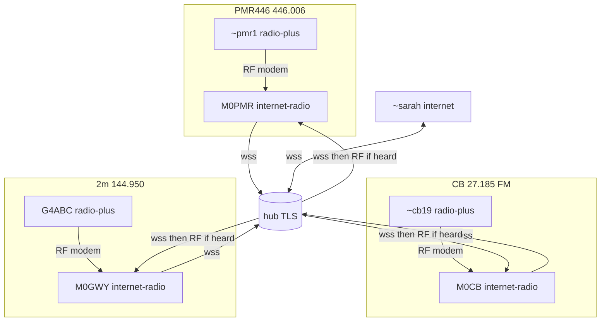

On the web: https://weechatradio.com/docs/bridging.html

WeeChat Radio — cross-frequency chat
A station talks on one dial at a time. Same-frequency chat is radio. Different-frequency chat uses a gateway and the hub.

Same frequency (no hub)

      .--------------- direct RF ---------------.
      |                                         v
   [ you ]   --RF-->   [ relay ]   --RF-->   [ them ]
   144.950             same dial             144.950
   2m radio            hops 3 -> 2           2m radio

Dial the same calling spot. Nearby stations hear you on the air. Any other station on that frequency can store-and-forward for you (TTL / hops_left, default 3), so you do not have to hear each other directly.

Different dials hear nothing

   [ you: 144.950 2m ]   - - -  X  - - -   [ them: 7.045 40m ]

There is no radio path between two frequencies, however strong the signals are. Someone has to bridge the two bands.

Different frequencies (hub bridge)

   (1) [ you ]          2m    144.950    radio
          |  RF
          v
   (2) [ gateway A ]    2m    internet-radio
          |  internet
          v
   (3) [ hub ]          routes by band: picks the gateway that
          |  internet   has recently heard them (or is them)
          v
   (4) [ gateway B ]    40m   internet-radio
          |  RF
          v
   (5) [ them ]         40m   7.045      radio

Each gateway is in internet-radio mode and stays on its own dial. The map ticker shows this as `2m -> 40m`.

Radio-plus (you stay offline)

   .....................................
   :   [ you ]  radio-plus, 2m         :   no internet here
   :......|............................:
          |  RF
          v
     [ gateway ]  --internet-->  [ hub ]
     hears you on 2m                |
                        .-----------+-----------.
                        v                       v
              [ internet station ]      [ another band ]

   never happens:   [ you ]  --X-->  [ hub ]

`radio` and `radio-plus` both post map telemetry when `[telemetry] url` is set, and that post never contains message text. Neither mode sends chat to the hub or the LAN from this computer. The only difference is whether an internet-radio gateway that hears you may forward your messages (and email) to the internet.

You never upload chat from this computer. A gateway that hears a radio-plus frame forwards it to the hub for any destination: a direct message, a closed group, and `#bulletin`. The frame says it may go to the internet. `radio` mode says do not forward, so a gateway keeps that frame on the radio. A closed group is also relayed on RF, so a member who only hears the gateway still gets it. A copy of that frame coming back from the hub does not cancel that relay, and one member's ACK does not either.

`[gateway] rf_egress` is the other direction. It puts hub traffic on the air. It does not decide the upload.

The sender's line shows `[gw]` when that gateway has accepted the frame onto the hub. `[rl]` is only “I heard my own frame on the radio again”. In `radio` mode `[rl]` is as far as the frame goes: a gateway will not upload it. Both marks can appear, and neither one is an ACK.

What a gateway will and will not put on the air

   hub gives this node a frame
        |
        v
   gateway with rf_egress = true?  -- no -->  stay quiet
        |  yes
        v
   dest heard on this dial in the
   last 10 minutes?                -- no -->  stay quiet
        |  yes
        v
   TX on this dial

A group counts as heard if any member was heard on this dial. Guest names starting with `~` also need `third_party = "allow"`.

Heard means **on RF on this frequency**, not a map pin or a LAN/hub sighting. A group flag by itself is not enough; at least one listed member must have been heard here in the last 10 minutes. `#bulletin` keys only if *someone* was heard on this dial over RF, so a silent gateway stays quiet.

What the program never does
- It never changes your radio frequency by itself. `/radio qsy` (or the FREQ list) is always your action.
- `radio` and `radio-plus` never put chat frames on the hub from this computer. Map data (callsign, grid, tx/rx ids — never message text) still POSTs if `[telemetry] url` is set. A gateway may forward `radio-plus` only.
- Internet traffic is not put on the air unless this node is a gateway, `rf_egress = true`, and the dest was recently heard on this frequency (or it is a group with members heard here).

Beacons carry `B|<mode>|<khz>` so peers and the map know your dial. Tell the app the dial if you have no CAT: `/radio freq 144.950`.

LAN: nodes on the same local network can also pass frames without the public hub. Gateway rules still apply.

Mixed band example (UK)

A closed group `#field` (`/join #field`) lets PMR446, CB, 2m amateur, and internet-only stations share one thread. Each band needs its own dial. There is no RF path between PMR446 (446.006 MHz), UK CB (27.185 MHz FM), and 2m (144.950 MHz), so cross-band chat always goes hub ↔ gateway ↔ RF on the destination band. The program never retunes your radio across bands for you, and you must stay within your licence (or licence-free rules) on the dial you set.

Who runs what (settings match setup and `/radio` commands today):

| Station | Mode | Callsign | Dial / channel | Modem preset | PTT | Hub from this PC | Notes |
| --- | --- | --- | --- | --- | --- | --- | --- |
| ~sarah | internet | `~sarah` | — | — | — | on (default) | `/join #field`. No radio hardware. |
| ~pmr1 | radio-plus | `~pmr1` | PMR446 446.006 MHz FM | `vhf-fm` | VOX | off | Handheld + audio cable; `/radio freq 446.006`. |
| ~cb19 | radio-plus | `~cb19` | UK CB CEPT ch 19 · 27.185 MHz FM | `vhf-fm` | VOX | off | Same preset as calling list for UK CB FM. |
| G4ABC | radio-plus | `G4ABC` | 2m 144.950 MHz FM | `vhf-fm` | CAT or VOX | off | UK/EU 2m calling spot from `wcr help calling`. |
| M0PMR | internet-radio | `M0PMR` | 446.006 MHz | `vhf-fm` | CAT or VOX | on | Gateway on PMR dial; `[gateway] rf_egress = true`. |
| M0CB | internet-radio | `M0CB` | 27.185 MHz | `vhf-fm` | CAT or VOX | on | Gateway on CB dial; `rf_egress = true`. |
| M0GWY | internet-radio | `M0GWY` | 144.950 MHz | `vhf-fm` | CAT or VOX | on | Gateway on 2m; `rf_egress = true`; optional `/tower on` for map pin. |

Guest names (`~…`) on RF need `[gateway] third_party = "allow"` on every gateway that should key their traffic onto the air. Default is `deny`.

What is encrypted: RF is modem audio and v2 frames on the air (not TLS). The public hub link is `wss://hub.weechatradio.com/ws` (TLS). LAN peers can exchange frames without the hub; gateway rules still apply.

Topology (static — animated version on the website):

Example `#field` thread (paths only):

1. `~pmr1`: “Car park set.” — RF on 446 MHz → M0PMR uploads (radio-plus) → hub (TLS) → ~sarah on hub; M0CB / M0GWY receive on hub and key onto CB / 2m only if `~cb19` / `G4ABC` were heard on that dial in the last 10 minutes (`rf_egress` and heard gate).
2. `~sarah`: “Copy, raining here.” — hub (TLS) to all connected `#field` members; gateways may RF-egress to bands where a member was heard.
3. `G4ABC`: “Convoy moving.” — RF on 144.950 → M0GWY → hub → internet and other gateways.
4. `~cb19`: “Roger.” — RF on 27.185 → M0CB → hub → others.
5. `M0GWY` keys an ACK back to `G4ABC` on 2m when the receipt returns on hub (same heard / `rf_egress` rules).

A PMR handheld cannot relay onto 2m or CB in the app: different dials, no cross-band RF. CB cannot “skip” to PMR without a gateway on each band and the hub between them.

Offline direct messages

The hub keeps a direct message for a station that is not connected, for 10 minutes, up to 32 messages per callsign. The oldest is dropped when that fills. It is delivered when that station next says hello. Closed groups and `#bulletin` are not held: someone has to be connected to receive them. The hub does not key a radio. A station that is only on the air still depends on the RF retry while both ends can hear the path.

How you know it worked
- Nicklist: `[2m] G4ABC`, `[40m] M7TJF`, `[inet] ~ALICE`
- Map BANDS panel and ticker: `G4ABC 2m TX -> #net -> 40m, inet`
- Status bar shows your own `144.950 2m`

Related: wcr help modes · wcr help calling
Guide: https://weechatradio.com/docs/bridging.html
