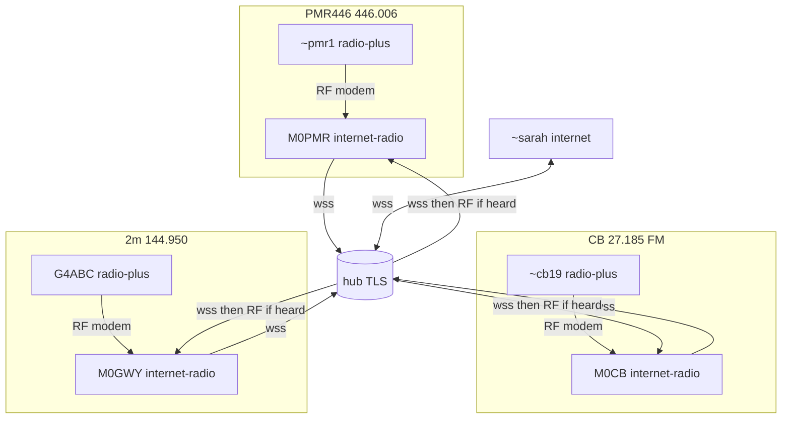

On the web: https://weechatradio.com/docs/mixed-band.html

# One group across PMR, CB, 2m, and internet

A closed group `#field` (`/join #field`) can include licence-free handhelds, licensed VHF, and an internet-only member. Each band is its own dial. There is no RF path between PMR446 (446.006 MHz), UK CB (27.185 MHz FM), and 2m (144.950 MHz), so cross-band chat always goes **gateway → hub (TLS) → gateway → RF** on the destination band. The program never retunes your radio across bands; stay within your licence or licence-free rules on the dial you set.

Cross-frequency rules: `wcr help bridging`. Suggested spots: `wcr help calling`.

## Who runs what

| Station | Mode | Callsign | Dial / channel | Preset | PTT | Hub | Notes |
| --- | --- | --- | --- | --- | --- | --- | --- |
| ~sarah | internet | `~sarah` | — | — | — | on | `/join #field`. No radio. |
| ~pmr1 | radio-plus | `~pmr1` | PMR446 446.006 MHz FM | `vhf-fm` | VOX | off | `/radio freq 446.006`. |
| ~cb19 | radio-plus | `~cb19` | UK CB CEPT ch 19 · 27.185 MHz FM | `vhf-fm` | VOX | off | UK CB FM row in calling list. |
| G4ABC | radio-plus | `G4ABC` | 2m 144.950 MHz FM | `vhf-fm` | CAT or VOX | off | UK/EU 2m calling spot. |
| M0PMR | internet-radio | `M0PMR` | 446.006 MHz | `vhf-fm` | CAT or VOX | on | `[gateway] rf_egress = true`. |
| M0CB | internet-radio | `M0CB` | 27.185 MHz | `vhf-fm` | CAT or VOX | on | `rf_egress = true`. |
| M0GWY | internet-radio | `M0GWY` | 144.950 MHz | `vhf-fm` | CAT or VOX | on | `rf_egress = true`; optional `/tower on`. |

Guest names (`~…`) on RF need `[gateway] third_party = "allow"` on every gateway that should key them (default `deny`).

**On the air:** modem v2 frames (not TLS). **Hub:** `wss://hub.weechatradio.com/ws` (TLS).

## Topology

Internet → RF only when the gateway has `rf_egress = true` and the destination was heard on that dial in the last 10 minutes.

## Example `#field` thread

1. `~pmr1`: “Car park set.” — RF 446 MHz → M0PMR (radio-plus upload) → hub (TLS) → ~sarah; other gateways key CB / 2m only if `~cb19` / `G4ABC` were heard there.
2. `~sarah`: “Copy, raining here.” — hub (TLS) to all `#field` members on the hub.
3. `G4ABC`: “Convoy moving.” — RF 144.950 → M0GWY → hub.
4. `~cb19`: “Roger.” — RF 27.185 → M0CB → hub.
5. Receipt to `G4ABC`: hub → M0GWY → RF 144.950 when egress rules pass.

PMR cannot relay onto CB or 2m on RF. CB cannot skip to PMR without a gateway on each band and the hub between them.

Related: `wcr help bridging` · `wcr help modes` · `wcr help calling`
