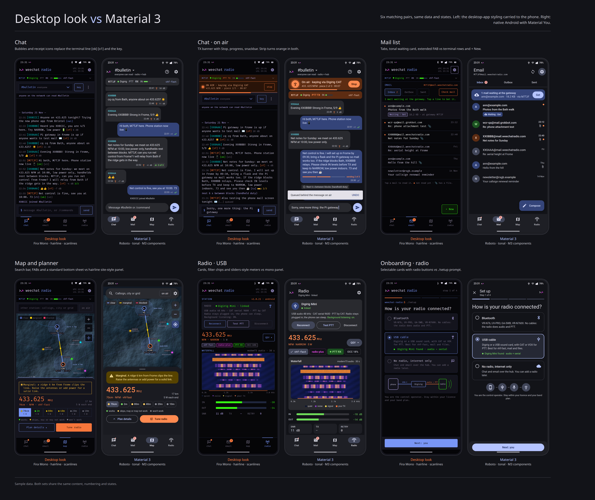
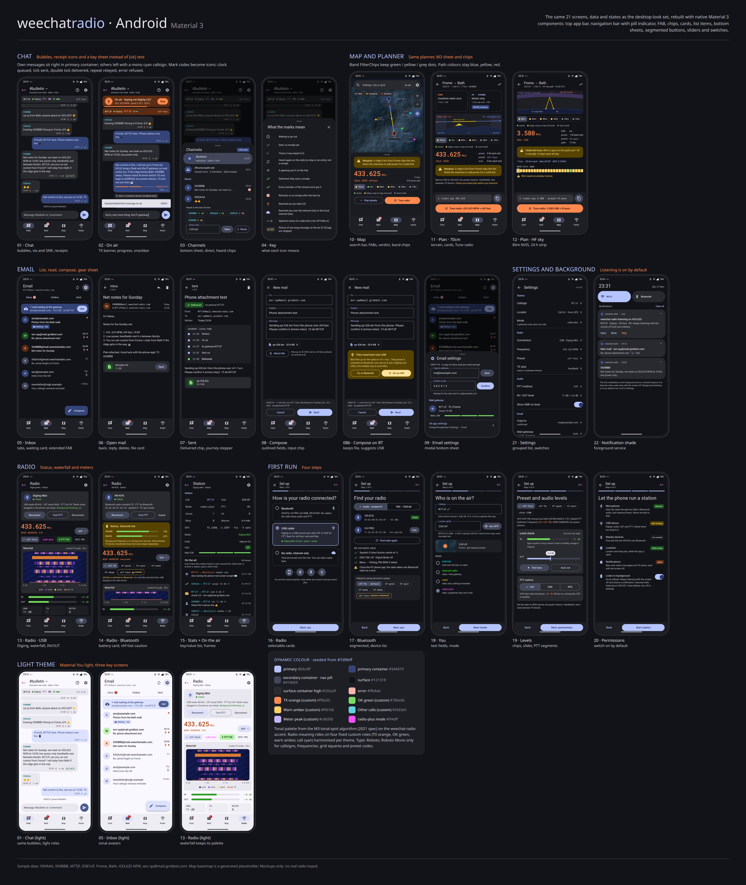

These are the designs to build the weechat-radio Android app from. Material 3 is the spec; desktop-look is reference only. They replace any earlier Android designs.

In this folder, `material/` is the Material 3 set (the handoff below calls it `android-material/`). `desktop-look/` is the reference set (called `android/` below). `src/` holds both generator trees and the commands that redraw the PNGs.

# weechat-radio Android — design handoff for Claude

**Material 3 is the primary visual and component spec for the Android build.**
The desktop-look set in `android/` is reference only: use it to check parity of content, states and radio meaning, not as the UI to implement.

These are static HTML/CSS mockups (412 × 915 dp frames, rendered at 2× to 824 × 1830 PNG). They are not built from app code. Do not ship the mockup HTML; rebuild the screens in native Android (Compose / Material 3).

Mockup sources and exact render commands live in the companion GitHub gist (see the gist README). Regenerating the PNGs is deterministic if you follow that README.

## Tobias's decisions (do not silently change these)

1. The phone is a **full station**, driving the radio over **Bluetooth** (Vero VR-N76: BT audio + PTT) or **USB** (Digirig or USB sound card, with CAT). Internet-only is a setup option, with a radio added later.
2. Phone callsign is plain **M7TJF** everywhere. Mail address is `M7TJF@mail.weechatradio.com`. Not `/M` or `/P`.
3. The **Pi mail gateway callsign is also M7TJF** (Pi, Frome).
4. On Bluetooth, show the **full preset ladder** with no warnings: vhf-fm (default), hf-good, hf-poor, hf-weak, hf-deep. **vhf-fast is selectable** and carries only a small **"untested on Bluetooth"** caution, pending an on-air test. Do not grey it out and do not assert that SBC "refuses" or "breaks" it in the UI.
5. **Mail attachments stay visible on Bluetooth**, with a clear suggestion to switch to USB (Digirig) for files / vhf-fast. Offer actions such as "Try on Bluetooth" and "Set up USB". Do not hide the attach control.
6. **Background listening is ON by default.** Keep a foreground service running with a persistent notification: **"weechat-radio listening on 433.625"**. Show a battery note. The Settings toggle and the onboarding permission switch default on. The user can turn it off in Settings.
7. **Never offer PMR446.**
8. **Dark theme is primary.** Also implement a Material You light theme (mockups include chat, mail list and radio USB as a check).
9. Implement the **Material 3** look, not the desktop-look mockups, and not any earlier Claude mobile designs.

## Sample data in the mockups

- Real / owner callsign used in the mockups: **M7TJF** (phone and gateway), locator **IO81UF**, Frome / Bath, 433.625 NFM, `wcr-qa@mail.grokbot.com`.
- Other on-air stations in the mockups use **obviously fake** callsigns, so they cannot be mistaken for real operators: **XX0AAA** (Frome), **XX0BBB** (Bath), **XX0CCC**, **XX0DDD**, **XX0EEE**, **XX0FFF**.
- Airtime figures such as "~1 min 45 s, 46 frames in 3 bursts, 12 s rest", battery percentages, BEACN / HOLD times, and "ridge 6 km from Frome" / sure range 4 km are **sample**. The map basemap is a generated placeholder, not real terrain.

## Palette (Material 3, seeded from #7d9bff)

Tonal-spot scheme, Material Color utilities 2021 spec, source colour **#7d9bff** (the weechat-radio accent). Exact dark / light roles are in `android-material/src/palette.json`.

Dark (primary) — selected roles:

| Role | Hex |
|---|---|
| primary | #b5c4ff |
| onPrimary | #1c2d61 |
| primaryContainer | #344479 |
| onPrimaryContainer | #dce1ff |
| secondary | #c1c5dd |
| secondaryContainer (nav pill) | #414659 |
| onSecondaryContainer | #dee1f9 |
| surface | #121318 |
| surfaceContainer | #1e1f25 |
| surfaceContainerHigh | #292a2f |
| onSurface | #e3e1e9 |
| onSurfaceVariant | #c6c6d0 |
| outline | #8f909a |
| outlineVariant | #45464f |
| error | #ffb4ab |

**Radio semantics are kept as fixed custom roles**, not taken from the dynamic scheme (so TX, OK, warn and the waterfall stay recognisable in both themes):

| Meaning | Dark | Light | Use |
|---|---|---|---|
| TX / own call / Tune radio / on-air banner | #ff8a50 (container #5d2c12) | #b3410a (container #ffdbc9) | On-air banner, own bubbles stay primary-container; strip turns TX-container while keying; Tune radio filled button; own-call emphasis |
| OK / delivered / linked | #78dc66 (container #1b5220) | #1d7a22 | Receipt double-tick, delivered chip, link LED, MAIL GW segments when up |
| Warn / untested / marginal / battery | #ffd166 (container #574300) | #7a5900 | "untested on Bluetooth", verdict Marginal, licence note, battery card |
| Other callsigns | #5fd3e0 | #006a73 | Mono callsign on received bubbles and heard chips |
| Mode colours (unchanged) | internet #00e5ff, internet-radio #39ff14, radio #ffbf00, radio-plus #ff4dff | same | Brand-mark wave takes the current mode colour (radio-plus magenta in the mockups) |

**IN / OUT meter zones** (same as desktop): green 0–66%, purple 66–88%, orange 88–100%.

**Waterfall palette** (same in light and dark; newest row at the top): quiet #0b1230, noise #8c3cc8, signal #ffe14d, your TX #ff7a3d. A passband bar sits under the canvas.

## Type

- **Roboto** (or Google Sans equivalent) for UI.
- **Roboto Mono only** for callsigns, frequencies, grid squares, preset codes and mail addresses.
- Do not use Fira Mono in the Android app; that is the desktop-look / desktop app face.

## Material 3 components to use

- Top app bar (small / headline as in the mockups). Settings is a gear in the app bar. On Email the gear is tonal and opens Email settings.
- NavigationBar with **pill active indicator**, labels Chat / Mail / Map / Radio, badge on Mail, optional pip on Chat.
- Extended FAB on the mail list ("Compose"). Regular / small FABs for map zoom and locate.
- Buttons: filled, tonal, outlined, text. Filled TX-coloured button for "Tune radio" and "Send" can stay the TX orange so the action is obvious.
- FilterChips for band plan (keep green / yellow / grey **dot** semantics: works / skips / won't work). FilterChips or assist chips for presets.
- Cards, list items (mail rows, settings rows, "on the air" frames).
- Modal bottom sheets: channel switcher, marks key, Email settings (Copy-to + gateway). A standard bottom sheet on the map for the verdict / frequency / Tune radio cluster.
- Segmented buttons: PTT CAT / VOX / RTS; Bluetooth Audio · modem73 vs TNC · 1200 bd.
- Slider (OUT level) with a value label; switches (Show SNR, Listen in background — default on).
- Snackbar (e.g. "Queued behind the message on air" + UNDO).
- Linear progress on the on-air banner.
- Outlined text fields, input chip for an attached file.
- Tabs (Inbox / Outbox / Sent).
- Foreground-service notification with Open, Mute and Stop.

## Radio meaning in the chat UI (Material)

Do not implement chat as the desktop terminal line. Use bubbles:

- Own messages right-aligned, primary container.
- Others left-aligned, a **mono cyan/teal callsign** above the text.
- Via is an icon (antenna = radio, cloud = internet / lan), then SNR in mono, then **receipt icons** instead of `[ok]` text:
  - clock = queued / waiting to go out
  - single tick = sent, no receipt yet
  - double tick (OK green) = delivered (`[ok]`) or all members of a closed room (`[all]`)
  - repeat = heard again on the radio (relay or echo), not a receipt (`[rl]`)
  - error = refused or no receipt after the last try (`[no]`)
- Grouped long messages: one bubble, `[1/3]` tags stripped, footer "3 of 3" or a 2-of-3 progress row while sending ("■■□ 2/3").
- A marks **key sheet** explains the icons (screen 04).
- While keying: an orange **On air** banner (method, frequency, piece n of n, elapsed, Stop) and the station strip turns TX-coloured.

Desktop-look screens keep the literal `[ok] [rf] [x1]` marks; that is reference for meaning only.

## Station strip

A compact one-line strip under the app bar: callsign, rig (linked), PTT RX or PTT TX, mini IN meter, preset. It turns the TX container colour while keying. The full station panel lives on the Radio tab. Bluetooth Radio also shows a battery card (phone and radio) and the vhf-fast caution.

## Screens (file names)

All paths below are under `android-material/` for the **build spec**, and the same numbering under `android/` for the desktop-look reference. Extra files: `08b` and `22`, plus `*-light` on Material only. Overview / compare boards are documentation, not app screens.

### Chat
| File | State |
|---|---|
| `01-chat.png` | #bulletin, RX idle, receipts, grouped 3 of 3, emoji |
| `02-chat-tx.png` | On air (Digirig CAT, piece 2 of 3, Stop), sending 2 of 3, queued line, rest note, snackbar |
| `03-chat-rooms.png` | Channel sheet: #bulletin, closed room, direct XX0BBB / XX0AAA, heard chips, open direct / + room |
| `04-chat-key.png` | Marks key sheet |

### Email (v1.0.21: one view at a time — list, read, compose)
| File | State |
|---|---|
| `05-mail-list.png` | Inbox, orange unread dots, 📎, waiting-at-gateway card, Check / Get, Compose FAB |
| `06-mail-open.png` | Back, 2 of 5, Reply / Delete, From / To / Subject / Received, 📎 net-plan.txt |
| `07-mail-open-sent.png` | Delivered chip, via M7TJF, hop journey in local time, attachment |
| `08-mail-compose.png` | To wcr-qa@mail.grokbot.com, 📎 qa-32k.bin, vhf-fast limit, airtime hint, Cancel / Send |
| `08b-mail-compose-bluetooth.png` | Same attachment kept; "Files travel best over USB"; Try on Bluetooth / Set up USB |
| `09-mail-settings.png` | Gear sheet: Copy-to + confirm code, mail gateway M7TJF · Pi, Frome, MAIL GW bar, "All app settings" |

### Map and planner
| File | State |
|---|---|
| `10-map.png` | Search, path verdict, sure-range rings, HOME / RX pins, other stations in mode colours, 433.625, band chips, Plan details / Tune radio |
| `11-plan-vhf.png` | Frome IO81UF → Bath IO81TJ, 17 km, Mobile antenna, terrain profile, `/radio qsy 433.625`, Tune radio |
| `12-plan-hf-sky.png` | 80m NVIS sky view, "Likely this hour", 24 h strip, licence warning, Tune radio 3.580 USB + hf-poor |

Path colours stay blue (clear), yellow (marginal), red (blocked). Band chips keep green / yellow / grey dots. "Tune radio" sets frequency and preset on the connected rig over CAT.

### Radio
| File | State |
|---|---|
| `13-radio-usb.png` | Digirig linked, 433.625 NFM NARROW, vhf-fast, waterfall, IN / OUT, SNR |
| `14-radio-bluetooth.png` | VR-N76 linked, battery card, full preset ladder, vhf-fast + "untested" caution, waterfall |
| `15-radio-stats-on-air.png` | CALL / GRID / GPS / MODE / PTT / RADIO / QUEUE / AIR / RETRY / BEACN / HOLD / HUB / MAIL GW, then "On the air" frame list |

### First run
| File | State |
|---|---|
| `16-onboarding-1-radio.png` | Bluetooth / USB (selected, Digirig found) / internet-only |
| `17-onboarding-1b-bluetooth.png` | Audio · modem73 vs TNC 1200 bd, VR-N76 found, radio checklist, preset ladder with vhf-fast caution |
| `18-onboarding-2-you.png` | Callsign M7TJF, locator IO81UF, Use GPS, mode cards (radio-plus selected) |
| `19-onboarding-3-levels.png` | Preset chips, IN meter, OUT slider, test tone / auto-set, PTT CAT / VOX / RTS + VOX threshold |
| `20-onboarding-4-permissions.png` | Mic, USB, nearby devices, location, notifications, **Listen in background switch ON** |

VR-N76 setup checklist (from product docs, still shown): squelch 0, KISS TNC off, Digital Mode off, pairing PIN 0000, close the HT app (one Bluetooth client at a time).

### Settings and system
| File | State |
|---|---|
| `21-settings.png` | Station / Radio / Audio / Email / Phone / About. "Listen in background" switch on, with "persistent notification · uses battery" |
| `22-notification-listening.png` | Shade: **"weechat-radio listening on 433.625"**, Open / Mute / Stop, plus mail and chat notifications |

### Light theme (Material only)
`01-chat-light.png`, `05-mail-list-light.png`, `13-radio-usb-light.png`.

### Boards (documentation)
- `android-material/00-overview-board.png` — all Material screens
- `android-material/00-compare-board.png` — six pairs, desktop-look vs Material (chat, chat-tx, mail list, map, radio USB, onboarding radio)
- `android/00-overview-board.png` — desktop-look reference set

## Implementation notes

- Contextual Email gear opens Copy-to and the gateway sheet, with a row through to all app settings. Do not put two gears on Email.
- Unread mail dot is **orange / TX colour**, matching the shipped desktop app (not blue).
- Mail files over radio are documented as working on vhf-fast, up to 512 KB (pictures shrunk to fit). The Bluetooth compose screen tells the user that vhf-fast is untested on Bluetooth and suggests USB for files.
- Bluetooth onboarding may still offer TNC 1200 bd (afsk-1200) as well as audio modem73.
- Desktop STATION panel becomes the one-line strip plus the Radio tab. Do not try to fit the full desktop panel above chat.
- You are the control operator: stay within licence and band plan. Show licence warnings on HF (e.g. 80m). Never offer PMR446.

## Out of scope for this handoff

- Do not treat the desktop-look typography, hairline 1 px terminal buttons, or scanlines as the Android visual system.
- Do not invent a different information architecture for v1; keep Chat / Mail / Map / Radio + onboarding + settings.
- Do not use realistic-looking placeholder callsigns in screenshots or sample data; keep M7TJF and the XX0AAA–XX0FFF series, or equally obviously fake substitutes.

## Index

### Material 3 (`material/`)

- [00-compare-board.png](material/00-compare-board.png) — Six pairs of the same state: desktop-look on the left, Material 3 on the right.
- [00-overview-board.png](material/00-overview-board.png) — Every Material 3 screen on one board, with the tonal palette.
- [01-chat.png](material/01-chat.png) — #bulletin at rest: bubbles, receipt icons, a grouped 3 of 3, and emoji.
- [01-chat-light.png](material/01-chat-light.png) — The same chat screen in the Material You light theme.
- [02-chat-tx.png](material/02-chat-tx.png) — On air with Digirig CAT, piece 2 of 3, a queued line, and a snackbar.
- [03-chat-rooms.png](material/03-chat-rooms.png) — Channel sheet: #bulletin, a closed room, directs, and heard chips.
- [04-chat-key.png](material/04-chat-key.png) — Marks key for clock, tick, double tick, repeat, and error.
- [05-mail-list.png](material/05-mail-list.png) — Inbox with orange unread dots, attachments, a waiting-at-gateway card, and Compose.
- [05-mail-list-light.png](material/05-mail-list-light.png) — The same inbox in the Material You light theme.
- [06-mail-open.png](material/06-mail-open.png) — Open message with reply, delete, and the net-plan.txt attachment.
- [07-mail-open-sent.png](material/07-mail-open-sent.png) — Sent mail with a Delivered chip, the hop journey in local time, and an attachment.
- [08-mail-compose.png](material/08-mail-compose.png) — Compose to wcr-qa with qa-32k.bin, the vhf-fast limit, and an airtime hint.
- [08b-mail-compose-bluetooth.png](material/08b-mail-compose-bluetooth.png) — The same attachment kept on Bluetooth, with Try on Bluetooth and Set up USB.
- [09-mail-settings.png](material/09-mail-settings.png) — Email gear sheet: Copy-to, gateway M7TJF in Frome, and the MAIL GW bar.
- [10-map.png](material/10-map.png) — Map with the path verdict, sure-range rings, band chips, and Tune radio.
- [11-plan-vhf.png](material/11-plan-vhf.png) — Frome to Bath on 70cm: terrain profile, Mobile antenna, and Tune radio.
- [12-plan-hf-sky.png](material/12-plan-hf-sky.png) — 80m NVIS sky path, a 24 hour strip, a licence warning, and Tune radio.
- [13-radio-usb.png](material/13-radio-usb.png) — Digirig linked on 433.625, vhf-fast, waterfall, and IN / OUT meters.
- [13-radio-usb-light.png](material/13-radio-usb-light.png) — The USB radio screen in the light theme. The waterfall palette stays the same.
- [14-radio-bluetooth.png](material/14-radio-bluetooth.png) — VR-N76 linked, battery card, full preset ladder, and the vhf-fast untested caution.
- [15-radio-stats-on-air.png](material/15-radio-stats-on-air.png) — Station stats (BEACN, HOLD, MAIL GW) and the on-the-air frame list.
- [16-onboarding-1-radio.png](material/16-onboarding-1-radio.png) — First run: Bluetooth, USB with a Digirig found, or internet only.
- [17-onboarding-1b-bluetooth.png](material/17-onboarding-1b-bluetooth.png) — Bluetooth audio versus TNC 1200, the VR-N76 checklist, and the preset ladder.
- [18-onboarding-2-you.png](material/18-onboarding-2-you.png) — Callsign M7TJF, locator IO81UF, Use GPS, and the mode cards.
- [19-onboarding-3-levels.png](material/19-onboarding-3-levels.png) — Preset chips, the IN meter, the OUT slider, and PTT CAT / VOX / RTS.
- [20-onboarding-4-permissions.png](material/20-onboarding-4-permissions.png) — Mic, USB, nearby devices, location, notifications, and background listening on.
- [21-settings.png](material/21-settings.png) — Station, radio, audio, email, and phone, with Listen in background switched on.
- [22-notification-listening.png](material/22-notification-listening.png) — Notification shade: weechat-radio listening on 433.625, with Open, Mute, and Stop.

### Desktop-look reference (`desktop-look/`)

- [00-overview-board.png](desktop-look/00-overview-board.png) — Every desktop-look screen on one board, with the desktop colour tokens.
- [01-chat.png](desktop-look/01-chat.png) — #bulletin as terminal lines: time, callsign, text, [rf] or [net], SNR, and [ok].
- [02-chat-tx.png](desktop-look/02-chat-tx.png) — On air: the strip turns orange, piece 2 of 3 is sending, and one line is queued.
- [03-chat-rooms.png](desktop-look/03-chat-rooms.png) — Channel list: #bulletin, a closed room, directs to XX0BBB and XX0AAA, and heard stations.
- [04-chat-key.png](desktop-look/04-chat-key.png) — Key for the literal marks ([ok], [rl], [no], [rf], and the rest).
- [05-mail-list.png](desktop-look/05-mail-list.png) — Inbox rows with an orange unread dot, attachments, and mail waiting at the gateway.
- [06-mail-open.png](desktop-look/06-mail-open.png) — Open message with back, reply, delete, and the attached file.
- [07-mail-open-sent.png](desktop-look/07-mail-open-sent.png) — Sent mail with a status chip and the hop journey in local time.
- [08-mail-compose.png](desktop-look/08-mail-compose.png) — Compose with an attachment, the airtime line, and Cancel / Send.
- [08b-mail-compose-bluetooth.png](desktop-look/08b-mail-compose-bluetooth.png) — Attachment kept on Bluetooth, with a suggestion to switch to USB.
- [09-mail-settings.png](desktop-look/09-mail-settings.png) — Copy-to and the mail gateway M7TJF, opened from the gear.
- [10-map.png](desktop-look/10-map.png) — Planner map: path verdict, band chips, sure range, and Tune radio.
- [11-plan-vhf.png](desktop-look/11-plan-vhf.png) — Frome IO81UF to Bath IO81TJ on 70cm, with the terrain profile and Tune radio.
- [12-plan-hf-sky.png](desktop-look/12-plan-hf-sky.png) — 80m NVIS sky view, the 24 hour strip, and the licence warning.
- [13-radio-usb.png](desktop-look/13-radio-usb.png) — Digirig panel with the waterfall and the IN / OUT meters.
- [14-radio-bluetooth.png](desktop-look/14-radio-bluetooth.png) — VR-N76 panel, battery note, full preset ladder, and the vhf-fast caution.
- [15-radio-stats-on-air.png](desktop-look/15-radio-stats-on-air.png) — CALL, GRID, PTT, QUEUE, BEACN, HOLD, MAIL GW, and the frames on the air.
- [16-onboarding-1-radio.png](desktop-look/16-onboarding-1-radio.png) — First-run prompt: Bluetooth, USB, or internet only.
- [17-onboarding-1b-bluetooth.png](desktop-look/17-onboarding-1b-bluetooth.png) — Find the VR-N76, pair it, and run the radio checklist.
- [18-onboarding-2-you.png](desktop-look/18-onboarding-2-you.png) — Callsign M7TJF, locator IO81UF, and the mode cards.
- [19-onboarding-3-levels.png](desktop-look/19-onboarding-3-levels.png) — Preset, IN meter, OUT level, and PTT CAT / VOX / RTS.
- [20-onboarding-4-permissions.png](desktop-look/20-onboarding-4-permissions.png) — Mic, USB, location, notifications, and background listening on.
- [21-settings.png](desktop-look/21-settings.png) — Station, radio, audio, email, and phone, with background listening on.
- [22-notification-listening.png](desktop-look/22-notification-listening.png) — Listening notification for the foreground service, on by default.

